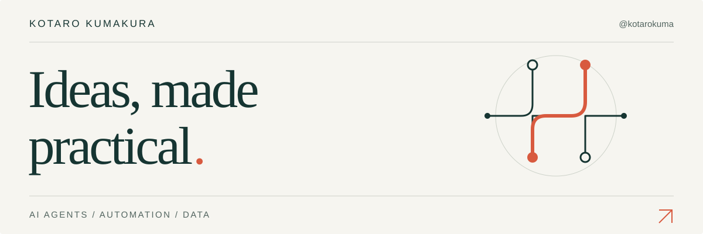

<picture>
  <source media="(prefers-color-scheme: dark)" srcset="assets/header-dark.svg">
  <source media="(prefers-color-scheme: light)" srcset="assets/header-light.svg">
  
</picture>

 

**企業の業務とAIをつなぎ、現場で使える形にする。**  
AIエンジニア・講師として、AIエージェントの活用、業務フローの設計、実践型の学習支援に取り組んでいます。

I bridge business workflows and AI through engineering, practical training, and hands-on support.

[仕事のご相談・協業 / Connect on LinkedIn](https://www.linkedin.com/in/kotaro-kumakura-b14131191/)

 

<picture>
  <source media="(prefers-color-scheme: dark)" srcset="assets/workflow-dark.svg">
  
</picture>

 

## 01 — Business × AI × Education

**AI agents & business workflows**  
業務の目的や必要な情報を整理し、AIエージェントの役割と、人の確認・承認を含む業務の流れを設計します。  
Turning business needs into clear agent roles and workflows, with relevant context and human review.

**Teaching & hands-on learning**  
「AIエージェント共創講座」の講師。教材・実践ワークの設計とライブデモを通じて、企業の実務者が自分の業務にAIを応用し、チームで改善していく力を育てます。  
Instructor for the AI Agent Co-Creation Course, creating materials, workshops, and live demos that help business users apply and improve AI workflows.

**Data & engineering**  
UC Irvineで学んだComputer Scienceを基盤に、Pythonによるデータ分析・可視化にも取り組んでいます。  
A computer science foundation from UC Irvine, with hands-on work in Python, data analysis, and visualization.

 

## 02 — Selected work

### AIエージェント共創講座 / AI Agent Co-Creation Course

日程調整・資料作成・営業・事務・採用などの業務を題材に、AIエージェントの設計、外部ツールとの連携、チームでの情報共有を扱う講座と実践ワークを設計しています。

I develop course materials and hands-on exercises around everyday business tasks, covering agent design, tool connections, team collaboration, and human review.

**My role** — 講師 / Instructor · ワーク設計 / Workshop design · ライブデモ / Live demonstrations

 

## 03 — Background & collaboration

**UC Irvine** — B.S. in Computer Science · 2023–2025  
**Orange Coast College** — A.S. in Computer Science · 2020–2023

企業のAI活用、実践型研修、AIエージェントや業務自動化の設計に関する仕事のご相談・協業を歓迎しています。

Open to AI adoption projects, practical training, workflow design, and business partnerships.  
[Let's build something useful. / LinkedInで話しましょう ↗](https://www.linkedin.com/in/kotaro-kumakura-b14131191/)
